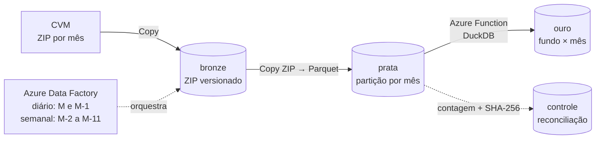

# adf-adls-medallion-ci

[](LICENSE)

Recarga da janela mutável de uma fonte pública que **reescreve o próprio passado**, com Azure
Data Factory, ADLS Gen2 em camadas (bronze, prata e ouro), Terraform e CI/CD no Azure Pipelines.

A fonte é o Informe Diário de fundos de investimento da CVM. Todo dia ela regrava o mês corrente
e o anterior, e toda semana os dez meses antes deles. Carregar só o mês novo deixa o lake errado
sem nenhum erro aparecer. A pergunta do projeto é **como recarregar o que a fonte republica sem
duplicar e sem perder linha, e provar isso**.

---

## Em um minuto

| | |
|---|---|
| **O que é** | CVM (ZIP por mês) → ADF (Copy) → ADLS Gen2: bronze (ZIP original, versionado) → prata (Parquet, uma partição por mês, trocada só depois de validada) → ouro (indicadores por fundo e mês, Azure Function com DuckDB) |
| **Com que dado** | Informe Diário da CVM: ~540 mil linhas por mês, 12 meses na janela. Baixado na execução, nunca versionado ([D1](docs/decisoes.md#d1-dado-público-real-baixado-na-execução-e-nunca-versionado)) |
| **Garantia** | No desenho, cada carga substitui o mês inteiro, só depois de validá-lo: reexecutar produz o mesmo resultado, e uma linha que a fonte removeu some do destino ([D6](docs/decisoes.md#d6-prata-substituída-por-mês-inteiro-só-depois-de-validada)). A lógica (substituição, contagem, hash) é provada na máquina com o dado real da CVM ([relatório](reports/prova.md)); o ADF executando não foi testado |
| **Como se prova** | Contagem e SHA-256 canônico por mês, bronze × prata, e uma republicação simulada (T0 → T1) que só pode mudar o mês republicado ([D7](docs/decisoes.md#d7-a-prova-contagem-e-sha-256-canônico-por-mês-e-republicação-simulada)) |
| **Infra e entrega** | Terraform (dev e prod), identidade gerenciada, Key Vault, GitHub Actions no CI e Azure Pipelines com aprovação de dev para prod |
| **O que não é** | Não foi aplicado na Azure: é o desenho de referência, com tudo que roda fora da nuvem validado na máquina e o roteiro de implantação em [`docs/runbook.md`](docs/runbook.md) (ver [Limites declarados](#limites-declarados)) |

**Para avaliar em 10 minutos:** [arquitetura](docs/arquitetura.md) →
[registro de decisões](docs/decisoes.md) → [como se testa](docs/testes.md) →
[relatório da prova](reports/prova.md).

## Arquitetura



Detalhes, layout do lake, segurança, ambientes e custo estimado: [`docs/arquitetura.md`](docs/arquitetura.md).

## Situação

| Parte | Situação |
|---|---|
| Desenho e decisões | pronto |
| Carga local e prova com o dado da CVM | pronto: 32 de 32 checagens com os arquivos reais de set, out e nov/2026 ([relatório](reports/prova.md)) |
| Terraform | pronto: dev e prod pelo mesmo módulo, bootstrap do estado e das permissões; `fmt`, `validate`, tflint, Checkov e 16 testes com provider simulado ([`infra/`](infra/README.md)) |
| ADF (JSON) | pronto: pipeline pai e filho, gatilhos diário e semanal; validate e export do ARM pelo pacote da Microsoft e 31 testes do JSON e do ARM ([`docs/adf.md`](docs/adf.md)) |
| CI/CD e runbook | pronto: Azure Pipelines com plano, aprovação e deploy de dev para prod (Terraform, Function, ADF); GitHub Actions sem credencial; YAML conferido no esquema; o passo a passo em [`docs/runbook.md`](docs/runbook.md) |

## A fonte reescrevendo o passado

Isto aconteceu durante o projeto. Setembro de 2026 tinha 538.663 linhas em 19/11/2026 e 538.758
em 24/11/2026. A CVM regravou o mês no sábado, 21/11, com 95 linhas a mais. Uma carga que não
recarregasse setembro ficaria com 95 linhas a menos, sem nenhum erro. Detalhes do dado em
[`docs/dado.md`](docs/dado.md).

## Como rodar

Precisa de Python 3.12 e [uv](https://docs.astral.sh/uv/).

```bash
uv sync --all-extras
uv run pytest                                   # 107 testes, dado sintético no formato da CVM
uv run cvm-lake baixar --competencias 202609 202610 202611
uv run cvm-lake prova --limpar                  # grava reports/prova.md e reports/prova.json
```

A prova roda sobre um lake vazio em `saida/prova`: carga inicial, reexecução, republicação
simulada de um mês e uma divergência injetada na staging. Ela termina com código 1 se qualquer
checagem falhar.

O Terraform se valida sem conta na Azure (precisa de Terraform, tflint e uv):

```bash
infra/validar.sh      # fmt, validate, tflint, Checkov e terraform test com provider simulado
```

O JSON do ADF também (precisa de Node 22):

```bash
ci/adf/validar.sh     # validate e export do ARM pelo pacote da Microsoft, e os testes do ARM
```

Sem o ARM gerado, os 4 testes do ARM ficam de fora do `uv run pytest`.

O pacote da Function e o arm-ttk (precisa de PowerShell 7):

```bash
uv run python ci/funcao/empacotar.py   # saida/funcao.zip, reprodutível, com o sha256
ci/adf/armttk.sh                       # arm-ttk sobre o ARM exportado
```

## Limites declarados

- **Não aplicado na Azure.** O ADF não tem emulador e o Azurite não implementa o ADLS Gen2, então
  a execução na nuvem é o passo do [runbook](docs/runbook.md). O que só a Azure confirma está em
  [`docs/testes.md`](docs/testes.md#só-na-azure).
- A tese é provada pela execução local da mesma lógica, nas mesmas pastas e com a mesma janela.
  A equivalência com o ADF executando só se confirma implantando.
- A republicação é simulada: a CVM não reapresenta um mês a pedido.
- Entre apagar e regravar a partição, um leitor concorrente veria o mês vazio. O único leitor é
  a etapa seguinte do próprio pipeline ([D6](docs/decisoes.md#d6-prata-substituída-por-mês-inteiro-só-depois-de-validada)).
- Só os últimos 12 meses do Informe Diário.

## Fonte do dado

Informe Diário de fundos de investimento, Comissão de Valores Mobiliários (CVM),
[dados.cvm.gov.br](https://dados.cvm.gov.br/dataset/fi-doc-inf_diario), sob a
[Open Database License (ODbL)](https://opendatacommons.org/licenses/odbl/1-0/). O repositório não
contém nem redistribui o dado.

## Licença

Código sob a licença [MIT](LICENSE).
