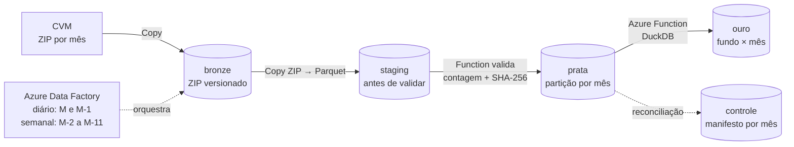

# cvm-azure-data-lake

[](https://github.com/alanjoffre/cvm-azure-data-lake/actions/workflows/ci.yml)


[](LICENSE)

Carga incremental com **janela de reprocessamento** (*lookback window*) de uma fonte pública
que **reescreve o próprio passado**, com Azure Data Factory, ADLS Gen2 em arquitetura medalhão
(bronze, prata e ouro), Azure Function com DuckDB, Terraform e CI/CD escrito para o Azure Pipelines
(YAML conferido contra o esquema).

A fonte é o Informe Diário de fundos de investimento da CVM. Todo dia ela regrava o mês corrente
e o anterior, e toda semana os dez meses antes deles. Carregar só o mês novo deixa o lake errado
sem nenhum erro aparecer. A pergunta do projeto é **como recarregar o que a fonte republica sem
duplicar e sem perder linha, e provar isso**.

**Desenho de referência, validado localmente; não aplicado na Azure.** O roteiro de implantação
está em [`docs/runbook.md`](docs/runbook.md).

---

## Em um minuto

| | |
|---|---|
| **O que é** | CVM (ZIP por mês) → ADF (Copy) → ADLS Gen2: bronze (ZIP original, versionado) → prata (Parquet, uma partição por mês, trocada só depois de validada) → ouro (indicadores por fundo e mês, Azure Function com DuckDB) |
| **Com que dado** | Informe Diário da CVM: ~540 mil linhas por mês, 12 meses na janela. Baixado na execução, nunca versionado ([D1](docs/decisoes.md#d1-dado-público-real-baixado-na-execução-e-nunca-versionado)) |
| **Por que importa** | Em 21/11/2026 a CVM regravou setembro com 95 linhas a mais. Uma carga só do mês novo ficaria sem elas, sem erro ([detalhes](#a-fonte-reescrevendo-o-passado)) |
| **Garantia** | No desenho, cada carga substitui o mês inteiro, só depois de validá-lo: reexecutar dá o mesmo resultado (carga idempotente), e uma linha que a fonte removeu some do destino ([D6](docs/decisoes.md#d6-prata-substituída-por-mês-inteiro-só-depois-de-validada)). Provado na máquina com o dado real da CVM ([relatório](reports/prova.md)) |
| **Como se prova** | Contagem e SHA-256 canônico por mês, bronze × prata, e uma republicação simulada (T0 → T1) que só pode mudar o mês republicado ([D7](docs/decisoes.md#d7-a-prova-contagem-e-sha-256-canônico-por-mês-e-republicação-simulada)) |
| **Infra e entrega** | Terraform (dev e prod), identidade gerenciada, Key Vault, GitHub Actions no CI e Azure Pipelines com aprovação de dev para prod |
| **O que não é** | Desenho de referência, validado localmente; não aplicado na Azure. O que só a Azure confirma está em [`docs/testes.md`](docs/testes.md#só-na-azure), e o roteiro, em [`docs/runbook.md`](docs/runbook.md) (ver [Limites declarados](#limites-declarados)) |

**Para avaliar em 10 minutos:** [relatório da prova](reports/prova.md) →
[registro de decisões](docs/decisoes.md) →
[`src/cvm_lake/funcao/prova.py`](src/cvm_lake/funcao/prova.py) (validar e reconciliar) →
[`adf/pipeline/pl_inf_diario_mes.json`](adf/pipeline/pl_inf_diario_mes.json) (os 7 passos de um mês) →
[como se testa](docs/testes.md).

## Arquitetura



Detalhes, layout do lake, segurança, ambientes e custo estimado:
[`docs/arquitetura.md`](docs/arquitetura.md).

## Situação

| Parte | Situação |
|---|---|
| Desenho e decisões | 13 decisões registradas ([`docs/decisoes.md`](docs/decisoes.md)) |
| Carga local e prova com o dado da CVM | validado na máquina: 32 de 32 checagens com os arquivos reais de set., out. e nov./2026 (nov. parcial, até 23/11) ([relatório](reports/prova.md)) |
| Terraform | validado sem conta: dev e prod pelo mesmo módulo, bootstrap do estado e das permissões; `fmt`, `validate`, tflint, Checkov e 16 testes com provider simulado (17 execuções: a raiz roda com dev e com prod) ([`infra/`](infra/README.md)) |
| ADF (JSON) | validado sem conta: pipeline pai e filho, gatilhos diário e semanal; validate e export do ARM pelo pacote da Microsoft e 31 testes do JSON e do ARM ([`docs/adf.md`](docs/adf.md)) |
| CI/CD e runbook | escrito e conferido no esquema: Azure Pipelines com plano, aprovação e deploy de dev para prod (Terraform, Function, ADF); GitHub Actions sem credencial; o passo a passo em [`docs/runbook.md`](docs/runbook.md) |

## Resultado da prova

Com os arquivos reais de set., out. e nov./2026, baixados em 24/11/2026
([relatório](reports/prova.md)):

| Etapa | O que se cobra | Checagens |
|---|---|---|
| Carga inicial | manifesto na carga, referência Python = DuckDB, staging apagada | 9 de 9 |
| Reexecução | mesmo hash e contagem, ouro idêntico, 2 versões na bronze | 9 de 9 |
| Republicação simulada de out/2026 (3 linhas alteradas, 1 removida, 1 incluída) | só outubro muda; cada linha conferida na prata | 10 de 10 |
| Divergência injetada na staging | a validação falha pelo hash, e a prata fica intacta | 4 de 4 |

Maior tempo da Function nesta máquina: 2,54 s (validar + reconciliar somados), contra os 230 s que
uma Function disparada por HTTP tem para responder a cada chamada.

## A fonte reescrevendo o passado

Isto aconteceu durante o projeto. Setembro de 2026 tinha 538.663 linhas em 19/11/2026 e 538.758
em 24/11/2026. A CVM regravou o mês no sábado, 21/11, com 95 linhas a mais. Uma carga que não
recarregasse setembro ficaria com 95 linhas a menos, sem nenhum erro. Detalhes do dado em
[`docs/dado.md`](docs/dado.md).

## Como rodar

Precisa de Python 3.12 e [uv](https://docs.astral.sh/uv/).

```bash
uv sync --all-extras
uv run pytest                                   # 103 passam e 4 ficam pulados: leem o ARM que ci/adf/validar.sh exporta
uv run cvm-lake baixar --competencias 202609 202610 202611
uv run cvm-lake prova --limpar                  # grava reports/prova.md e reports/prova.json
```

Os testes usam dado sintético no formato da CVM. Os arquivos baixados são os do dia: como a CVM
regrava os meses, contagens e hashes podem diferir dos do relatório versionado (arquivos baixados em 24/11/2026).

A prova roda sobre um lake vazio em `saida/prova`: carga inicial, reexecução, republicação
simulada de um mês e uma divergência injetada na staging. Ela termina com código 1 se qualquer
checagem falhar.

O Terraform se valida sem conta na Azure (precisa de Terraform, tflint e uv):

```bash
infra/validar.sh      # fmt, validate, tflint, Checkov e terraform test com provider simulado
```

O JSON do ADF também (precisa de Node 22):

```bash
ci/adf/validar.sh     # validate e export do ARM pelo pacote da Microsoft, e os testes do ARM
```

Sem o ARM gerado, os 4 testes do ARM são pulados. Depois do `ci/adf/validar.sh`,
`ADF_ARM=saida/arm uv run pytest` roda os 107.

O pacote da Function e o arm-ttk (o arm-ttk precisa de PowerShell 7):

```bash
uv run python ci/funcao/empacotar.py   # saida/funcao.zip, reprodutível, com o sha256
ci/adf/armttk.sh                       # arm-ttk sobre o ARM exportado
```

## Limites declarados

- **Não aplicado na Azure.** O ADF não tem emulador e o Azurite não implementa o ADLS Gen2, então
  a execução na nuvem é o passo do [runbook](docs/runbook.md). O que só a Azure confirma está em
  [`docs/testes.md`](docs/testes.md#só-na-azure).
- A tese é provada pela execução local da mesma lógica, nas mesmas pastas e com a mesma janela.
  A equivalência com o ADF executando só se confirma implantando.
- A republicação é simulada: a CVM não reapresenta um mês a pedido.
- Entre apagar e regravar a partição, um leitor concorrente veria o mês vazio. O único leitor é
  a etapa seguinte do próprio pipeline ([D6](docs/decisoes.md#d6-prata-substituída-por-mês-inteiro-só-depois-de-validada)).
- Só os últimos 12 meses do Informe Diário.

## Estrutura

```
src/cvm_lake/      carga local, hash canônico, validação e reconciliação (o código da Function)
funcao_azure/      a Azure Function (HTTP: validar e reconciliar)
adf/               JSON do Data Factory: linked services, datasets, pipelines e gatilhos
infra/             Terraform: módulo do ambiente, dev e prod, bootstrap do estado e testes
ci/                validação do ADF, arm-ttk, pacote da Function e scripts do deploy
azure-pipelines.yml  CI e deploy de dev para prod, com plano e aprovação
.github/workflows/ CI público, sem credencial da Azure
docs/              arquitetura, decisões, dado, ADF, testes e runbook
reports/           relatório da prova local com o dado real
tests/             pytest
```

## Fonte do dado

Informe Diário de fundos de investimento, Comissão de Valores Mobiliários (CVM),
[dados.cvm.gov.br](https://dados.cvm.gov.br/dataset/fi-doc-inf_diario), sob a
[Open Database License (ODbL)](https://opendatacommons.org/licenses/odbl/1-0/). O repositório não
contém nem redistribui o dado.

## Licença

Código sob a licença [MIT](LICENSE).
