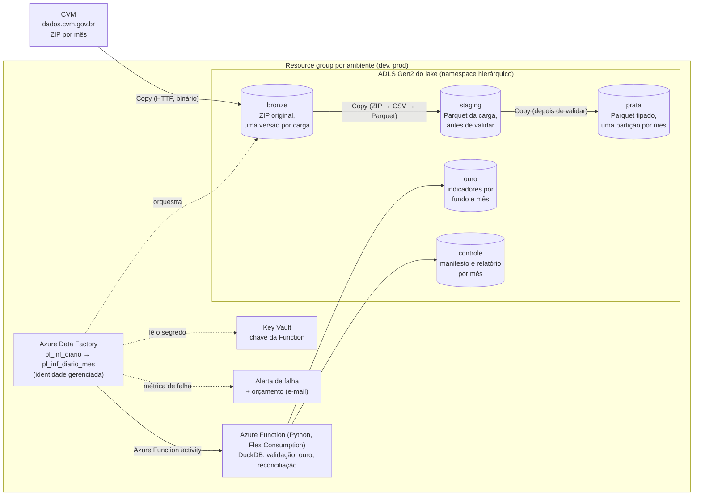
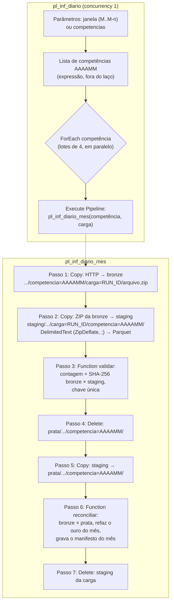
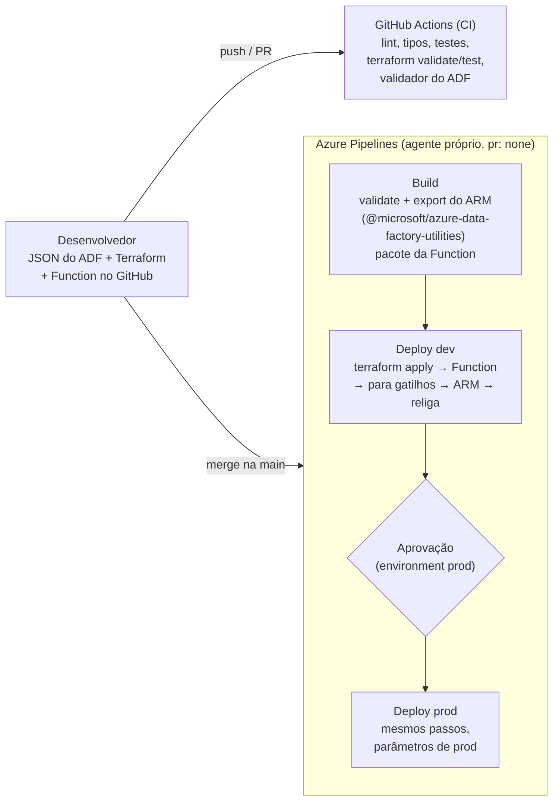

# Arquitetura

Como uma fonte pública que **reescreve o próprio passado** chega a um data lake na Azure sem
duplicar e sem perder linha. A orquestração fica com o Azure Data Factory (ADF) e o armazenamento
com o ADLS Gen2. A infraestrutura é Terraform, e a promoção de dev para prod é feita pelo
Azure Pipelines.

As decisões e o motivo de cada uma estão em [`decisoes.md`](decisoes.md) (citadas aqui como
D1, D2…). O que se testa na máquina e o que só a Azure testa está em [`testes.md`](testes.md).

---

## 1. A fonte e o problema

**Informe Diário de fundos de investimento da CVM**
([dados.cvm.gov.br](https://dados.cvm.gov.br/dataset/fi-doc-inf_diario), licença ODbL, ver D1):

| Item | Valor (conferido em 19/11/2026) |
|---|---|
| Arquivo | um ZIP por mês de competência: `inf_diario_fi_AAAAMM.zip`, com um CSV dentro |
| Endereço | `https://dados.cvm.gov.br/dados/FI/DOC/INF_DIARIO/DADOS/inf_diario_fi_AAAAMM.zip` |
| Tamanho | ~11 MB compactado; ~54 MB e ~540 mil linhas descompactado (set/2026: 538.663 linhas) |
| Formato | CSV com `;`, quebra de linha CRLF, cabeçalho na 1ª linha, datas `AAAA-MM-DD`, decimal com ponto |
| Colunas | `TP_FUNDO_CLASSE`, `CNPJ_FUNDO_CLASSE`, `ID_SUBCLASSE`, `DT_COMPTC`, `VL_TOTAL`, `VL_QUOTA`, `VL_PATRIM_LIQ`, `CAPTC_DIA`, `RESG_DIA`, `NR_COTST` ([dicionário](https://dados.cvm.gov.br/dados/FI/DOC/INF_DIARIO/META/meta_inf_diario_fi.txt)) |
| Chave natural | `CNPJ_FUNDO_CLASSE` + `ID_SUBCLASSE` + `DT_COMPTC`: 0 duplicados em set/2026. Sem a subclasse, há 8.013 duplicados, então a subclasse faz parte da chave (D4) |
| Metadados HTTP | `ETag`, `Last-Modified` e `Content-Length` em cada arquivo |

**O contrato de atualização, nas palavras da CVM:** os meses corrente (M) e anterior (M-1)
"serão atualizados diariamente com as eventuais reapresentações", de segunda a sábado, às
08:00. Os meses M-2 a M-11 "serão atualizados semanalmente". A listagem do servidor em 19/11
confirma: de dez/2025 a set/2026, todos foram regravados em 14/11; out/2026 e nov/2026, em 19/11.
Os meses anteriores a M-11 não mudam mais.

**Consequência:** carregar só o mês novo deixa o lake errado em silêncio, porque uma
reapresentação de agosto muda agosto, não o mês corrente. O pipeline precisa recarregar a
**janela de reprocessamento** (*lookback window*) e congelar o resto. Essa é a tese do projeto:

> A recarga da janela mutável substitui os meses que a CVM republica, sem duplicar e sem perder
> linha. A reconciliação confere isso por contagem e SHA-256 por mês de competência.

## 2. Visão geral



Papéis (D2):
- **ADF:** orquestra e move. Busca o arquivo, descompacta, converte e grava, sem cluster de
  Spark.
- **Function:** faz o que exige lógica: a validação, o ouro e a prova. O volume é de ~540 mil
  linhas por mês, e o DuckDB resolve em memória.
- **ADLS Gen2:** é o lake.

## 3. O pipeline do ADF

Dois pipelines: o pai (`pl_inf_diario`) monta a lista de meses e chama o filho
(`pl_inf_diario_mes`) uma vez por mês. O filho pode ser executado e testado sozinho, e reprocessar
um mês é chamar o pai com aquele mês na lista (D6). Dois gatilhos seguem o contrato da fonte (D3):

| Gatilho | Quando | Meses | Por quê |
|---|---|---|---|
| `tr_diario` | seg a sáb, 10:00 (horário de Brasília) | M e M-1 | a CVM atualiza esses dois às 08:00 |
| `tr_semanal` | domingo, 10:00 | M-2 a M-11 | atualização semanal da CVM (premissa em D3) |
| execução manual | sob demanda | lista explícita (`competencias`) | carga inicial e reprocessamento forçado |

O pai tem `concurrency: 1`: uma execução que chega com outra em andamento (o semanal e uma manual,
por exemplo) fica na fila, e duas cargas nunca mexem no mesmo mês ao mesmo tempo.



Pontos de desenho:
- **Bronze é imutável e versionada** (D5). Cada carga grava em `carga=<RUN_ID>`, e nada é
  sobrescrito. Dá para auditar o que a CVM publicou em cada dia e reprocessar sem baixar de novo.
  Uma regra de ciclo de vida apaga as versões com mais de 90 dias.
- **A partição só é trocada depois de validada** (D6, D7). A versão nova vai primeiro para a
  staging, e a Function confere contagem, hash e chave contra a bronze. Se diverge, a Function
  responde erro, a atividade falha, e a prata continua com a versão anterior.
- **Prata é substituída por mês inteiro**, nunca recebe append (D6). Rodar duas vezes dá o mesmo
  resultado, e uma reapresentação substitui a anterior sem deixar linhas velhas.
- **Janela de reprocessamento** (D3). O que é mais antigo que M-11 está congelado e não volta a
  ser lido. O manifesto de cada mês registra a carga vigente, a contagem, o hash e o `ETag` da
  origem.
- **Cada mês escreve só nos próprios caminhos.** A staging e o manifesto têm a competência no
  caminho, então os 4 meses em paralelo nunca gravam no mesmo arquivo.
- **Na descompactação, `preserveZipFileNameAsFolder = false`.** Sem isso, o Copy cria uma subpasta
  com o nome do ZIP, e os caminhos dos passos seguintes não batem. Os arquivos Parquet saem com o
  nome que o Copy gera, e quem lê usa a pasta inteira (`.../competencia=AAAAMM/*.parquet`).
- **O Delete seguido de Copy não é atômico.** Entre os passos 4 e 5, um leitor concorrente veria o
  mês vazio. Se o passo 5 falhar, o mês fica vazio até a próxima carga, e o alerta avisa. Aqui o
  único leitor é a Function, no passo 6. Com leitores concorrentes, a saída é um formato de tabela
  com transação (Delta Lake), registrado em D6 como evolução.
- **Retentativa só onde é segura.** Copy e Delete têm retentativa (2 vezes). As chamadas à
  Function não têm, e a resposta dela tem de chegar em até 230 s, o limite do ADF para essa
  atividade.
- **Falha não é silenciosa.** A Function responde erro quando a prova não bate, o pipeline falha e
  o alerta pela métrica de execuções com falha do ADF manda e-mail.

## 4. Camadas e layout no ADLS

Uma conta de armazenamento por ambiente para o lake, com namespace hierárquico (é isso que a
torna ADLS Gen2), e um container por camada:

```
bronze/cvm/inf_diario/competencia=202609/carga=<RUN_ID>/inf_diario_fi_202609.zip
staging/cvm/inf_diario/carga=<RUN_ID>/competencia=202609/*.parquet
prata/cvm/inf_diario/competencia=202609/*.parquet
ouro/cvm/inf_diario_mensal/competencia=202609/*.parquet
controle/cvm/inf_diario/competencia=202609/manifesto.json
controle/cvm/inf_diario/competencia=202609/carga=<RUN_ID>.json
```

| Camada | Conteúdo | Regra |
|---|---|---|
| bronze | o ZIP exatamente como veio | imutável; uma versão por carga; ciclo de vida de 90 dias |
| staging | o Parquet da carga, antes de validar | apagado no fim da carga; ciclo de vida de 7 dias para o que sobrar de uma falha |
| prata | Parquet com os campos do dicionário da CVM (data, decimal, inteiro) | uma partição por mês; substituída inteira; chave única (D4) |
| ouro | por fundo/classe, subclasse e mês: PL e cotistas no último dia, captação, resgate e captação líquida no mês, variação da cota no mês | refeito por mês a partir da prata |
| controle | por mês: o manifesto (carga vigente, linhas, hash, ETag) e um relatório por carga | escrito pela Function, um arquivo por mês |

**Tipos na prata.** O tipo físico que o Copy do ADF grava no Parquet (precisão e escala do
decimal, `DATE` ou timestamp) só se confirma executando na Azure. A reconciliação converte os dois
lados para a escala do dicionário antes do hash, e uma divergência derruba a carga em vez de passar
em silêncio. Se o Copy não gravar os tipos do dicionário, vale o plano B (D2b).

## 5. A prova: contagem e hash por mês

A validação (antes da troca) e a reconciliação (depois) respondem às mesmas perguntas (D7):
1. **Não perdeu e não duplicou?** A contagem de linhas do CSV na bronze é igual à do Parquet, e a
   chave natural é única.
2. **Não alterou nada no caminho?** O SHA-256 do conteúdo canônico da bronze é igual ao do Parquet.
   O conteúdo canônico são as linhas ordenadas pela chave, com cada campo num formato fixo
   (decimal com a escala do dicionário, data ISO, vazio = nulo), o que torna o hash independente
   do formato do arquivo.

A reconciliação ainda confere que o ouro soma as mesmas linhas da prata. A Function responde
sempre um objeto JSON (`ok`, contagens, hashes), como o ADF exige.

**A republicação é simulada**, porque não dá para pedir à CVM que reapresente um mês. Duas
versões do mesmo mês (T0, a real, e T1, com linhas alteradas, uma removida e uma incluída) passam
pelo pipeline em sequência. O resultado esperado:
- a prata do mês é igual a T1 (hash);
- os outros meses não mudam (hash igual ao anterior);
- reexecutar não muda nada;
- a bronze guarda as duas versões.

## 6. Ambientes e promoção (CI/CD)



- **Dois ambientes completos** (dev e prod), cada um no próprio resource group, com o mesmo
  Terraform e um arquivo de variáveis por ambiente (D8).
- **O JSON no repositório é a fonte da verdade** (D9). Nenhum ambiente é editado à mão: os dois
  recebem o ARM gerado no build.
- **Publicação moderna:** o pacote npm da Microsoft valida a fábrica e exporta o ARM no CI, sem o
  botão "Publish" nem o branch `adf_publish` (D9).
- **A Function sobe antes do ADF**, porque o linked service do ADF aponta para ela.
- **Gatilhos param antes do deploy e voltam depois**, com o script em PowerShell que a Microsoft
  publica para isso, porque o ARM não atualiza um gatilho que está rodando.
- **Autenticação do pipeline sem segredo:** service connection por federação de identidade
  (*workload identity federation*) (D10).
- **Agente próprio** (auto-hospedado), que nunca roda código de terceiros: o pipeline de deploy
  não dispara em PR, e o build de PR de fork fica desligado na organização (D10).

## 7. Segurança

| Tema | Desenho |
|---|---|
| Acesso ao lake | Identidade gerenciada do ADF e da Function com `Storage Blob Data Contributor` só na conta do lake do ambiente. A chave de acesso compartilhada da conta do lake fica **desligada** |
| Armazenamento da Function | O host da Function (plano Flex Consumption) usa uma conta de armazenamento própria, também sem chave compartilhada, acessada pela identidade gerenciada: `Storage Blob Data Owner` e `Storage Table Data Contributor` só nessa conta, o mínimo que a Microsoft documenta para o host. O pacote publicado fica num container dela (D2) |
| Segredos | Só um: a chave da Function, que o ADF lê do Key Vault pela identidade gerenciada (`Key Vault Secrets User`). O deploy grava a chave no cofre (`Key Vault Secrets Officer`), e ela nunca passa pelo estado do Terraform. A fonte é pública e anônima, então não há credencial de origem (D11) |
| Deploy | Federação de identidade, sem senha de service principal no Azure DevOps. A identidade do pipeline tem `Contributor` no resource group de cada ambiente e `Role Based Access Control Administrator` com condição: só cria e remove atribuições dos 5 papéis de [`papeis_atribuiveis.json`](../infra/papeis_atribuiveis.json) (`Storage Blob Data Contributor`, `Storage Blob Data Owner`, `Storage Table Data Contributor`, `Key Vault Secrets User` e `Key Vault Secrets Officer`), e só a principais de serviço. O módulo do ambiente lê a mesma lista: um papel fora dela quebra o plano. No estado remoto, só `Storage Blob Data Contributor` no container do estado |
| Agente | Pipeline de deploy com `pr: none` e build de PR de fork desligado na organização (D10) |
| Rede | Endpoints públicos com TLS 1.2 mínimo e sem acesso anônimo a blob. Endpoint privado e VNet gerenciada ficam fora por custo (D12) |
| Repositório | Nenhum ID de assinatura, tenant ou segredo versionado: a assinatura e o tenant chegam por `ARM_*`, os e-mails de alerta por `TF_VAR_emails_alerta` e a conta do estado por `-backend-config`, todos variáveis do pipeline |

## 8. Custo estimado

Estimativa para um mês de operação. Não é medição. Os preços são os públicos de varejo (USD, east
US 2, pela Retail Prices API da Azure em 19/11/2026) e serão conferidos na calculadora de preços
antes de qualquer execução.

Um mês de operação são ~92 cargas de mês: 2 meses × ~26 dias do gatilho diário + 10 meses × ~4
domingos do semanal.

| Item | Uso | Ordem de grandeza |
|---|---|---|
| ADF: execuções de atividade | ~92 cargas × ~8 atividades (com o Execute Pipeline) ≈ 750; contagem exata a conferir na calculadora | ~US$ 1 por 1.000 execuções |
| ADF: cópia (DIU-hora) | 3 cópias por carga, poucos segundos cada (cobrança mínima de 1 minuto) | alguns dólares |
| ADLS Gen2 | ~1 GB (bronze com 90 dias + prata + ouro) | centavos |
| Function (Flex Consumption) | ~184 chamadas de segundos (2 por carga) | a conferir na calculadora |
| Key Vault | poucas leituras de segredo | centavos |
| Azure DevOps | 1 usuário Basic; agente próprio (o *tier* auto-hospedado inclui 1 job paralelo sem limite de tempo) | a máquina do agente é de quem implanta |

Fora de propósito, por serem os medidores caros: Data Flow, VNet gerenciada, Log Analytics,
endpoint privado. As travas de custo para quem for implantar estão no
[`runbook.md`](runbook.md).

## 9. Limites do desenho

A declaração geral (o que foi validado e o que não foi aplicado) está nos
[Limites declarados do README](../README.md#limites-declarados). Limites próprios do desenho:
- A republicação é simulada (T0 → T1).
- Se o Copy do passo 5 falhar, o mês fica vazio na prata até a próxima carga (seção 3).
- O dia da atualização semanal da CVM é uma premissa observada, não um contrato (D3).
- Só o Informe Diário dos últimos 12 meses. O histórico anual (`DADOS/HIST/`) fica fora.
- A variação da cota no mês usa o primeiro e o último dia com informe no mês, e não o último dia
  do mês anterior.
