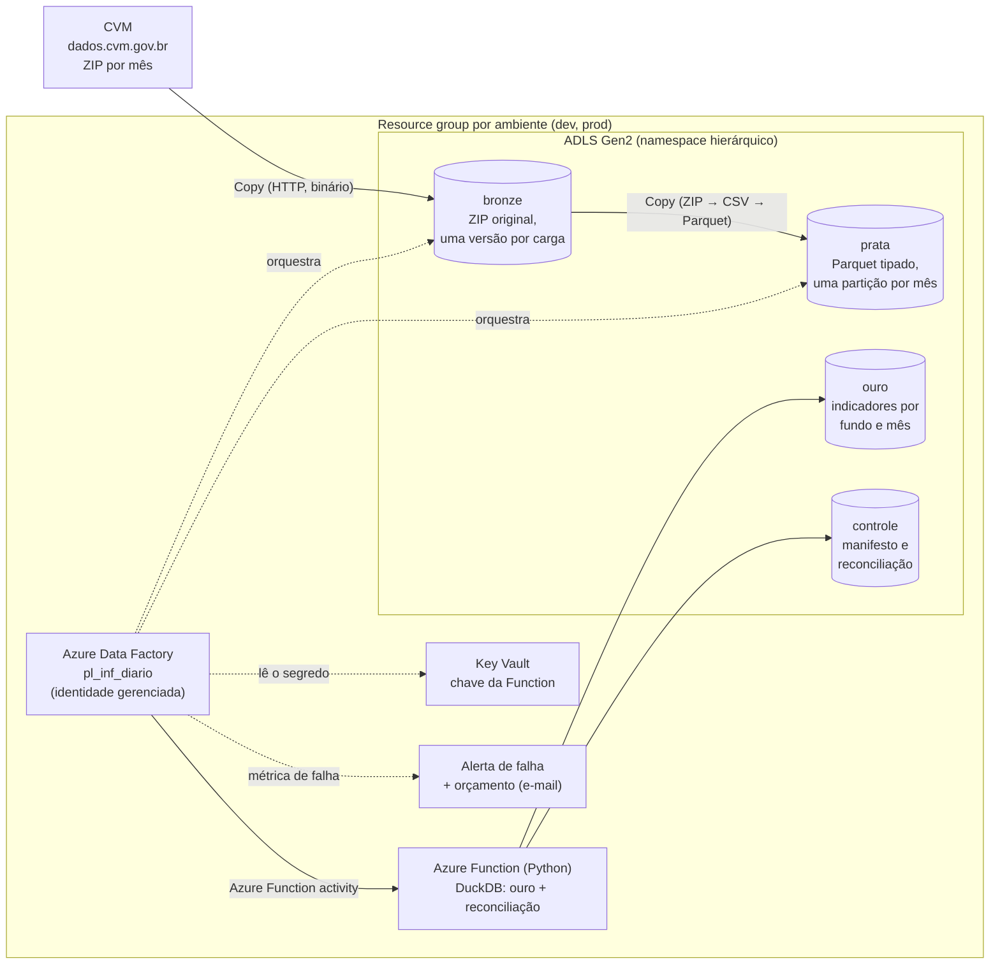
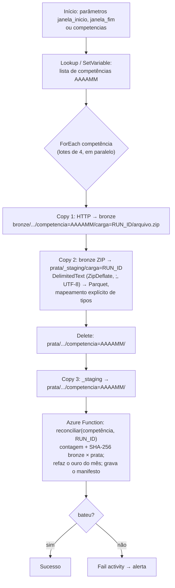
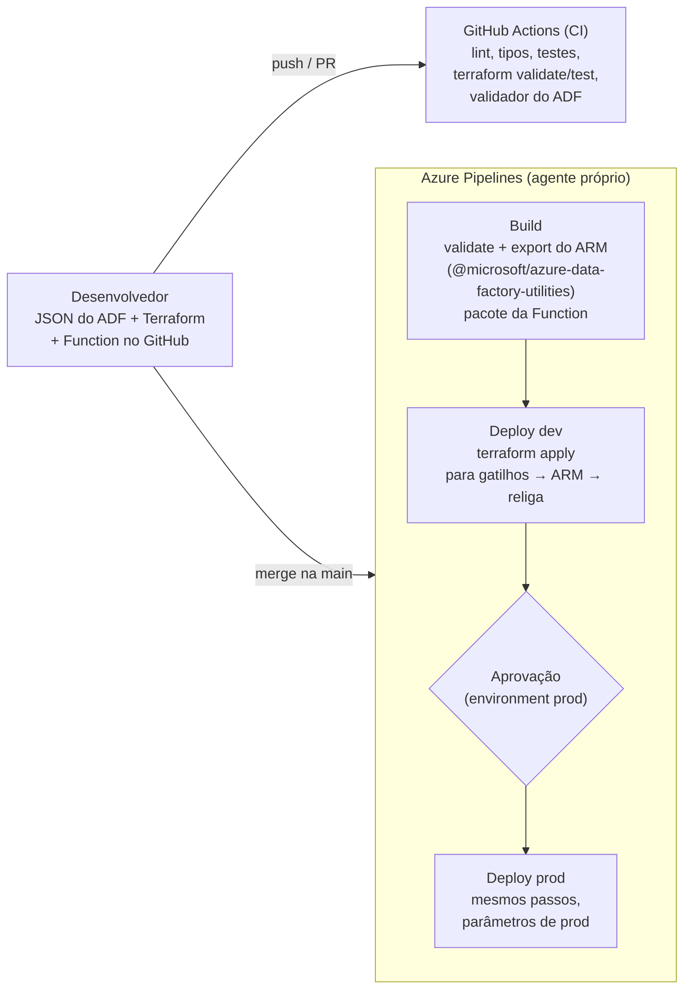

# Arquitetura

Como uma fonte pública que **reescreve o próprio passado** chega a um data lake na Azure sem
duplicar e sem perder linha. A orquestração fica com o Azure Data Factory (ADF) e o armazenamento
com o ADLS Gen2. A infraestrutura é Terraform, e a promoção de dev para prod é feita pelo
Azure Pipelines.

As decisões e o motivo de cada uma estão em [`decisoes.md`](decisoes.md) (citadas aqui como
D1, D2…). O que se testa na máquina e o que só a Azure testa está em [`testes.md`](testes.md).

---

## 1. A fonte e o problema

**Informe Diário de fundos de investimento da CVM**
([dados.cvm.gov.br](https://dados.cvm.gov.br/dataset/fi-doc-inf_diario), licença ODbL, ver D1):

| Item | Valor (conferido em 19/11/2026) |
|---|---|
| Arquivo | um ZIP por mês de competência: `inf_diario_fi_AAAAMM.zip`, com um CSV dentro |
| Endereço | `https://dados.cvm.gov.br/dados/FI/DOC/INF_DIARIO/DADOS/inf_diario_fi_AAAAMM.zip` |
| Tamanho | ~11 MB compactado; ~54 MB e ~540 mil linhas descompactado (set/2026: 538.663 linhas) |
| Formato | CSV com `;`, quebra de linha CRLF, cabeçalho na 1ª linha, datas `AAAA-MM-DD`, decimal com ponto |
| Colunas | `TP_FUNDO_CLASSE`, `CNPJ_FUNDO_CLASSE`, `ID_SUBCLASSE`, `DT_COMPTC`, `VL_TOTAL`, `VL_QUOTA`, `VL_PATRIM_LIQ`, `CAPTC_DIA`, `RESG_DIA`, `NR_COTST` ([dicionário](https://dados.cvm.gov.br/dados/FI/DOC/INF_DIARIO/META/meta_inf_diario_fi.txt)) |
| Chave natural | `CNPJ_FUNDO_CLASSE` + `ID_SUBCLASSE` + `DT_COMPTC`: 0 duplicados em set/2026. Sem a subclasse, há 8.013 duplicados, então a subclasse faz parte da chave (D4) |
| Metadados HTTP | `ETag`, `Last-Modified` e `Content-Length` em cada arquivo |

**O contrato de atualização, nas palavras da CVM:** os meses corrente (M) e anterior (M-1)
"serão atualizados diariamente com as eventuais reapresentações", de segunda a sábado, às
08:00. Os meses M-2 a M-11 "serão atualizados semanalmente". A listagem do servidor em 19/11
confirma: de dez/2025 a set/2026, todos foram regravados em 14/11; out/2026 e nov/2026, em 19/11.
Os meses anteriores a M-11 não mudam mais.

**Consequência:** carregar só o mês novo deixa o lake errado em silêncio, porque uma
reapresentação de agosto muda agosto, não o mês corrente. O pipeline precisa recarregar a
**janela mutável** e congelar o resto. Essa é a tese do projeto:

> A carga incremental reprocessa os meses que a CVM republica, sem duplicar e sem perder, e
> prova isso por contagem e hash SHA-256 por mês de competência.

## 2. Visão geral



Papéis (D2):
- **ADF:** orquestra e move. Busca o arquivo, descompacta, tipa e grava, sem cluster de Spark.
- **Function:** faz o que exige lógica (agregação e prova). O volume é de ~540 mil linhas por
  mês, e o DuckDB resolve em memória.
- **ADLS Gen2:** é o lake.

## 3. O pipeline do ADF

Um pipeline parametrizado (`pl_inf_diario`) e dois gatilhos, que seguem o contrato da fonte (D3):

| Gatilho | Quando | Meses (`janela`) | Por quê |
|---|---|---|---|
| `tr_diario` | seg a sáb, 10:00 (horário de Brasília) | M e M-1 | a CVM atualiza esses dois às 08:00 |
| `tr_semanal` | domingo, 10:00 | M-2 a M-11 | atualização semanal da CVM |
| execução manual | sob demanda | lista explícita (`competencias`) | carga inicial e reprocessamento forçado |



Pontos de desenho:
- **Bronze é imutável e versionado** (D5). Cada carga grava em `carga=<RUN_ID>`, e nada é
  sobrescrito. Dá para auditar o que a CVM publicou em cada dia e reprocessar sem baixar de novo.
  Uma regra de ciclo de vida apaga as versões com mais de 90 dias.
- **Prata é substituída por mês inteiro**, nunca recebe append (D6). Reescrever a partição
  inteira a partir da versão mais nova torna a carga **idempotente**: rodar duas vezes dá o mesmo
  resultado, e uma reapresentação substitui a anterior sem deixar linhas velhas.
- **Watermark = fronteira da janela mutável** (D3). O que é mais antigo que M-11 está congelado e
  não volta a ser lido. O manifesto em `controle/` registra, por mês, a carga vigente, a
  contagem, o hash e o `ETag` da origem.
- **O Delete seguido de Copy não é atômico.** Entre os dois passos, um leitor concorrente veria o
  mês vazio. Aqui o único leitor é a Function, chamada depois, no mesmo pipeline. Com leitores
  concorrentes, a saída é um formato de tabela com transação (Delta Lake), registrada em D6 como
  evolução.
- **Falha não é silenciosa.** Se a reconciliação não bate, o pipeline falha (Fail activity), e o
  alerta por métrica (`PipelineFailedRuns > 0`) manda e-mail.

## 4. Camadas e layout no ADLS

Uma conta de armazenamento por ambiente, com namespace hierárquico (é isso que a torna ADLS
Gen2), e um container por camada:

```
bronze/cvm/inf_diario/competencia=202609/carga=<RUN_ID>/inf_diario_fi_202609.zip
prata/cvm/inf_diario/competencia=202609/part-00000.parquet
prata/cvm/inf_diario/_staging/carga=<RUN_ID>/...
ouro/cvm/inf_diario_mensal/competencia=202609/part-00000.parquet
controle/cvm/inf_diario/manifesto.json
controle/cvm/inf_diario/reconciliacao/carga=<RUN_ID>.json
```

| Camada | Conteúdo | Regra |
|---|---|---|
| bronze | o ZIP exatamente como veio | imutável; uma versão por carga; ciclo de vida de 90 dias |
| prata | Parquet com os tipos do dicionário da CVM (`date`, `decimal(17,2)`, `decimal(27,12)` para a cota, `int`) | uma partição por mês; substituída inteira; chave única (D4) |
| ouro | por fundo/classe, subclasse e mês: PL e cotistas no último dia, captação, resgate e captação líquida no mês, variação da cota no mês | refeito por mês a partir da prata |
| controle | manifesto (mês → carga vigente, linhas, hash, ETag) e um relatório por carga | escrito pela Function, lido pelo pipeline e pelos testes |

## 5. A prova: contagem e hash por mês

A reconciliação (D7) responde a duas perguntas para cada mês carregado:
1. **Não perdeu e não duplicou?** A contagem de linhas do CSV na bronze é igual à da prata, e a
   chave natural é única na prata.
2. **Não alterou nada no caminho?** O SHA-256 do conteúdo canônico da bronze é igual ao da prata.
   O conteúdo canônico são as linhas ordenadas pela chave, com cada campo num formato fixo
   (decimal com a escala do dicionário, data ISO, vazio = nulo), o que torna o hash independente
   do formato do arquivo.

E a uma pergunta do ouro: a soma das linhas agregadas por mês é igual às linhas da prata.

**A republicação é simulada**, porque não dá para pedir à CVM que reapresente um mês. Duas
versões do mesmo mês (T0, a real, e T1, com linhas alteradas, uma removida e uma incluída) passam
pelo pipeline em sequência. O resultado esperado:
- a prata do mês é igual a T1 (hash);
- os outros meses não mudam (hash igual ao anterior);
- reexecutar não muda nada;
- a bronze guarda as duas versões.

## 6. Ambientes e promoção (CI/CD)



- **Dois ambientes completos** (dev e prod), cada um no próprio resource group, com o mesmo
  Terraform e um arquivo de variáveis por ambiente (D8).
- **O ADF de dev pode ser ligado ao GitHub** (integração Git) para quem prefere editar no ADF
  Studio. A fonte da verdade é o JSON no repositório. Prod nunca é editado à mão: só recebe o ARM
  gerado no build (D9).
- **Publicação moderna:** o pacote npm da Microsoft valida a fábrica e exporta o ARM no CI, sem o
  botão "Publish" nem o branch `adf_publish` (D9).
- **Gatilhos param antes do deploy e voltam depois**, com o script que a Microsoft documenta para
  isso, porque o ARM não atualiza um gatilho que está rodando.
- **Autenticação do pipeline sem segredo:** service connection por federação de identidade
  (*workload identity federation*) (D10).
- **Agente próprio** (auto-hospedado), por custo e por não depender de concessão de paralelismo
  (D10).

## 7. Segurança

| Tema | Desenho |
|---|---|
| Acesso ao lake | Identidade gerenciada do ADF e da Function com `Storage Blob Data Contributor` só na conta do ambiente. A chave de acesso compartilhada da conta fica **desligada** (`shared_access_key_enabled = false`) |
| Segredos | Só um: a chave da Function, que o ADF lê do Key Vault pela identidade gerenciada (`Key Vault Secrets User`). A fonte é pública e anônima, então não há credencial de origem (D11) |
| Deploy | Federação de identidade, sem senha de service principal no Azure DevOps. A identidade do pipeline tem `Contributor` no resource group e `Role Based Access Control Administrator` com condição (só pode atribuir os 3 papéis acima) |
| Rede | Endpoints públicos com TLS 1.2 mínimo e sem acesso anônimo a blob. Endpoint privado e VNet gerenciada ficam fora por custo (limite declarado) |
| Repositório | Nenhum ID de assinatura, tenant ou segredo versionado: vão em variáveis do pipeline e em `*.tfvars` fora do Git |

## 8. Custo estimado

Estimativa para um mês de operação, com preços públicos de varejo (USD, east US 2). Os valores
serão conferidos na API de preços da Azure antes de qualquer execução. Não é medição.

| Item | Uso | Ordem de grandeza |
|---|---|---|
| ADF: execuções de atividade | ~2 meses × 5 atividades × 26 dias + ~10 meses × 5 × 4 domingos ≈ 460 | ~US$ 0,50 |
| ADF: cópia (DIU-hora) | ~3 cópias por mês carregado, poucos segundos cada (cobrança mínima de 1 minuto) | alguns dólares |
| ADLS Gen2 | ~1 GB (bronze com 90 dias + prata + ouro) | centavos |
| Function (consumo) | ~150 chamadas de segundos | dentro da franquia mensal |
| Key Vault | poucas leituras de segredo | centavos |
| Azure DevOps | 1 usuário Basic + agente próprio | grátis |

Fora de propósito, por serem os medidores caros: Data Flow, VNet gerenciada, Log Analytics,
endpoint privado. As travas de custo para quem for implantar estão no
[`runbook.md`](runbook.md).

## 9. Limites declarados

- **Desenho de referência, validado localmente; não aplicado na Azure.** O que roda na máquina e
  o que só a Azure confirma está em [`testes.md`](testes.md).
- A tese é provada pela execução local da mesma lógica (mesmas pastas, mesma janela, mesma
  reconciliação). A equivalência com o ADF executando só se confirma implantando.
- A republicação é simulada (T0 → T1).
- Um leitor concorrente pode ver o mês vazio entre o Delete e o Copy (seção 3).
- Só o Informe Diário dos últimos 12 meses. O histórico anual (`DADOS/HIST/`) fica fora.
- A variação da cota no mês usa o primeiro e o último dia com informe no mês, e não o último dia
  do mês anterior.
